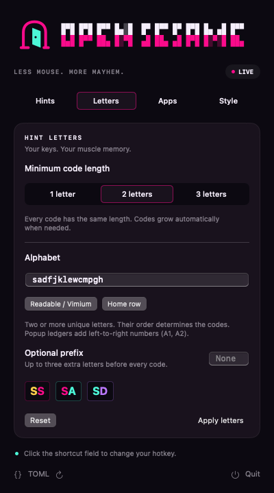
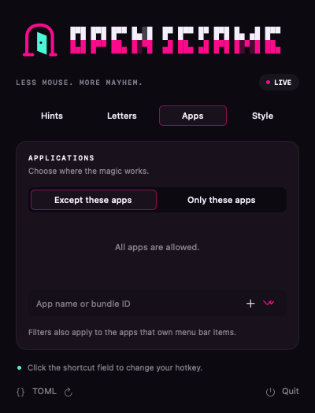
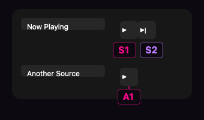
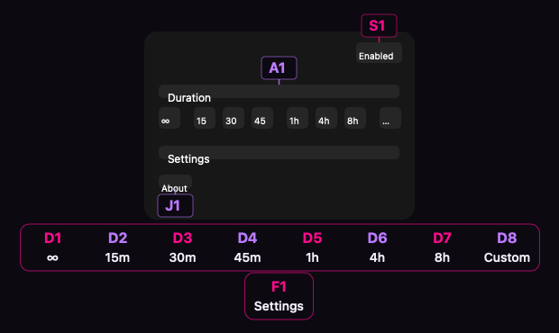
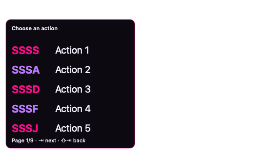
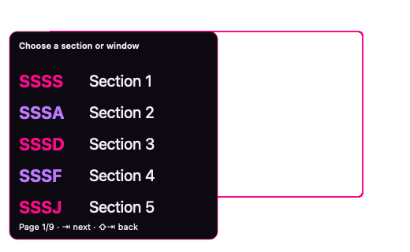
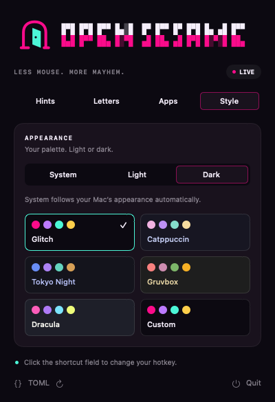
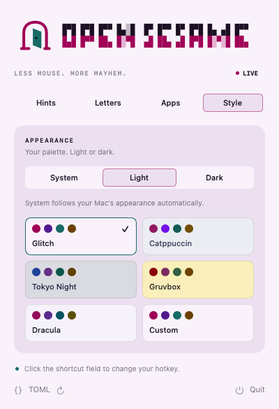

<p align="center">
  <picture>
    <source srcset="asset/logo-dark.svg" media="(prefers-color-scheme: dark)">
    <source srcset="asset/logo-light.svg" media="(prefers-color-scheme: light)">
    
  </picture>
</p>

<p align="center">Your Mac. A hotkey. A little keyboard witchcraft.</p>

<p align="center">
  <a href="LICENSE"></a>
  <a href="https://www.swift.org"></a>
  
  <a href="https://conventionalcommits.org"></a>
  <a href="https://just.systems"></a>
</p>

I built this for myself because I wanted Vimium-style keyboard hints across
my Mac, including Ghostty tabs, separate windows, and the menu bar, with hint
size, letters, and app filters I could tune from the menu bar.

<table align="center">
  <tr>
    <td align="center" width="33%"><a href="asset/settings-hints.png"></a></td>
    <td align="center" width="33%"><a href="asset/settings-letters.png"></a></td>
    <td align="center" width="33%"><a href="asset/settings-apps.png"></a></td>
  </tr>
  <tr>
    <td align="center"><sub>Hints</sub></td>
    <td align="center"><sub>Letters</sub></td>
    <td align="center"><sub>Apps</sub></td>
  </tr>
</table>

*Settings previews rendered from the app's native views.*

## Features

| Feature | What it does |
| --- | --- |
| Keyboard hints | Press one hotkey, then type a label to activate an accessible control. Crowded windows first offer spatial sections; choose one to reveal its controls. |
| Menu access | Include app menus and optional menu bar extras. Hints follow menus and popups opened through a selection. |
| Tab and window switching | Teal hints select tabs; gold hints select other visible windows of the same app. Selecting either ends hint mode so you can type. |
| Configurable hint size | Adjust text and badge size from 10–22 pt, with a snapping scale and Compact / Default / Large presets. |
| Hint letters | Vimium’s readable default alphabet avoids V/Y and I/O/Q lookalikes. Choose a minimum of 1, 2, or 3 letters, a custom alphabet, and an optional prefix. Codes grow uniformly when needed; two letters is the default. |
| Clear labels | Pink/violet control hints and contrasting typed letters. Compact control rows use one horizontal strip in clear space above or below the controls, with captions when placed outside a popup. Text menus use numbered side ledgers with Tab / Shift–Tab paging. Close and window-size controls are excluded. |
| Web-based apps | Target semantic controls and links; skip structural containers, headings, and plain text. |
| App filters | Allow only selected apps or exclude specific apps, using names or bundle IDs. |
| Themes | Glitch, Catppuccin, Tokyo Night, Gruvbox, Dracula, or your own Custom colors. The dropdown branding, menu bar icon, controls, and hints change together. |
| Light and dark | Each theme has both variants. Follow macOS automatically with System, or choose Light / Dark. |
| Shortcut recorder | Click the summon shortcut, then press your preferred combination. Escape cancels recording. |
| Saved preferences | Settings are saved to TOML. Open the file or reload edits from the menu bar panel. |

## How hints look

Press the hotkey, release it, then type the code. Hints stay close to controls
when space allows. Crowded rows use a captioned strip; when local placement
cannot fit, a paged panel keeps every discovered action reachable.

<table align="center">
  <tr>
    <td align="center" width="50%"><a href="asset/detail-media-pair.png"></a></td>
    <td align="center" width="50%"><a href="asset/detail-duration-row.png"></a></td>
  </tr>
  <tr><td align="center"><sub>Local hints · media controls</sub></td><td align="center"><sub>Horizontal strip · duration choices</sub></td></tr>
  <tr>
    <td align="center"><a href="asset/layout-overflow.png"></a></td>
    <td align="center"><a href="asset/layout-section-overflow.png"></a></td>
  </tr>
  <tr><td align="center"><sub>Overflow · Tab / Shift+Tab to page</sub></td><td align="center"><sub>Section selection · choose an area first</sub></td></tr>
</table>

*Rendered examples use the real hint canvas over synthetic controls. They show
layout and typography; live behavior depends on each app's Accessibility tree.*

## Themes

<table align="center">
  <tr>
    <td align="center" width="50%"><a href="asset/theme-glitch-dark.png"></a></td>
    <td align="center" width="50%"><a href="asset/theme-glitch-light.png"></a></td>
  </tr>
  <tr><td align="center"><sub>Dark</sub></td><td align="center"><sub>Light</sub></td></tr>
</table>

Theme presets adapt palettes from [Catppuccin](https://catppuccin.com/),
[Tokyo Night](https://github.com/folke/tokyonight.nvim),
[Gruvbox](https://github.com/morhetz/gruvbox), and [Dracula](https://draculatheme.com/)
for readable native hints. Glitch is OpenSesame's own pink-and-teal palette.

## Quickstart

For now, run from a checkout. Requires macOS 13+, Swift 6+ from Apple's
[Command Line Tools](https://developer.apple.com/xcode/resources/), and
[just](https://just.systems). TOML parsing uses TOMLDecoder, as in HocusFocus.

```sh
just start
```

1. Enable **OpenSesame** in **System Settings → Privacy & Security → Accessibility**
   when prompted.
2. Click the **open door** in the menu bar to adjust your preferences.
3. Focus an app and press **Control + Shift + Space** (the default shortcut). Release the keys, then
   type the hint label to select a control.

**Escape** dismisses hints. **Backspace** edits the code. The hotkey toggles the
session. When hints cannot fit locally, a paged action panel keeps them reachable:
**Tab** advances a page and **Shift + Tab** goes back. Codes stay the same as you
type to filter. **Command + Shift + 3** takes a screenshot while hints remain visible.
Passive focus changes from HocusFocus keep hints up; a click or scroll dismisses them.

## Prototype notes

OpenSesame reads macOS Accessibility controls. Apps with incomplete trees,
canvas content, and custom dropdowns may expose fewer targets. Discovery has a
time budget, so large trees can return a partial set. Ordinary controls use
Accessibility actions; menu extras use a verified center click. There is no
arbitrary pixel-click fallback for ordinary controls.

Secure Input can prevent keyboard capture. macOS and other apps may reserve shortcut combinations.
There is no launch-at-login yet. Builds are ad-hoc signed unless you set
`OPENSESAME_SIGNING_IDENTITY`; this is not a notarized distribution.

## Contributing

See [CONTRIBUTING.md](CONTRIBUTING.md) for development, testing, and troubleshooting,
and the [manual trial checklist](MANUAL-TEST.md) for real interaction checks.

## License

[MIT](LICENSE).
