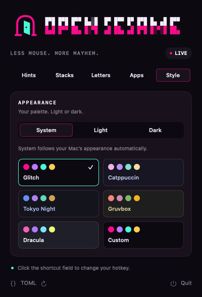
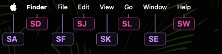
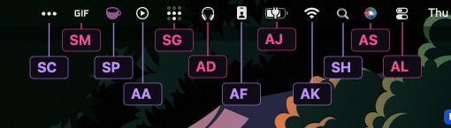
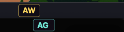

<p align="center">
  <picture>
    <source srcset="asset/logo-dark.svg" media="(prefers-color-scheme: dark)">
    <source srcset="asset/logo-light.svg" media="(prefers-color-scheme: light)">
    
  </picture>
</p>

<p align="center">Your Mac. A hotkey. A little keyboard witchcraft.</p>

<p align="center">
  <a href="LICENSE"></a>
  <a href="https://www.swift.org"></a>
  
  <a href="https://github.com/dduan/TOMLDecoder"></a>
  <a href="https://conventionalcommits.org"></a>
  <a href="https://just.systems"></a>
  <a href="https://github.com/tekk/hovnokod-badge"></a>
</p>

I built this for myself because I wanted Vimium-style keyboard hints across
my Mac, including Ghostty tabs, separate windows, and the menu bar, with a
hotkey and hint size I could tune from the menu bar.

<table align="center">
  <tr>
    <td align="center" width="50%"><a href="asset/settings-hints.png"></a></td>
    <td align="center" width="50%"><a href="asset/settings-style.png"></a></td>
  </tr>
  <tr>
    <td align="center"><sub>Configuration</sub></td>
    <td align="center"><sub>Style</sub></td>
  </tr>
  <tr>
    <td align="center"><a href="asset/live-app-menus.png"></a></td>
    <td align="center"><a href="asset/live-menu-bar.png"></a></td>
  </tr>
  <tr>
    <td align="center"><sub>App menus · live capture</sub></td>
    <td align="center"><sub>Menu bar extras · live capture</sub></td>
  </tr>
  <tr>
    <td align="center"><a href="asset/live-window-tabs.png"></a></td>
    <td align="center"><a href="asset/detail-duration-row.png"></a></td>
  </tr>
  <tr>
    <td align="center"><sub>Ghostty windows and tabs · live capture</sub></td>
    <td align="center"><sub>Duration controls · rendered example</sub></td>
  </tr>
</table>

## Features

| Feature | What it does |
| --- | --- |
| Keyboard hints | Press one hotkey, then type a label to activate an accessible control. |
| Menu access | Include app menus and optional menu bar extras. Hints follow menus and popups opened through a selection. |
| Tab and window switching | Teal hints select tabs; gold hints select other visible windows of the same app. Selecting either ends hint mode so you can type. |
| Configurable hint size | Adjust text and badge size using the snapping slider or Compact, Default, and Large presets. |
| Hint letters | Choose the alphabet, code length, and optional prefix. Two letters is the default. |
| Crowded controls | Choose a section first in dense windows. Controls that cannot fit locally remain reachable in a paged panel. |
| App filters | Allow only selected apps or exclude specific apps, using names or bundle IDs. |
| Appearance | Choose Glitch, Catppuccin, Tokyo Night, Gruvbox, Dracula, or custom colors. Follow the system appearance or choose light or dark. |
| Saved preferences | Settings are saved to TOML. Open the file or reload edits from the menu bar panel. |

## Quickstart

For now, run from a checkout. Requires macOS 13+, Swift 6+ from Apple's
[Command Line Tools](https://developer.apple.com/xcode/resources/), and
[just](https://just.systems).

```sh
just start
```

1. Enable **OpenSesame** in **System Settings → Privacy & Security → Accessibility**
   when prompted.
2. Click the **open door** in the menu bar to adjust your preferences.
3. Focus an app and press **Control + Shift + Space**. Release the keys, then type
   the hint label to select a control. Click the shortcut field to change the hotkey.

Click outside the panel or press Escape to close it.

While hints are open, Escape dismisses them and Backspace edits the code. Tab and
Shift+Tab navigate paged panels. Command+Shift+3 takes a screenshot without hiding
the hints. A click or scroll dismisses them; passive focus changes from HocusFocus
do not.

OpenSesame relies on each app's Accessibility controls. Custom interfaces can
expose fewer actions. Builds are ad-hoc signed and are not notarized.

## Contributing

See [CONTRIBUTING.md](CONTRIBUTING.md) for development, testing, and troubleshooting.

## License

[MIT](LICENSE)
