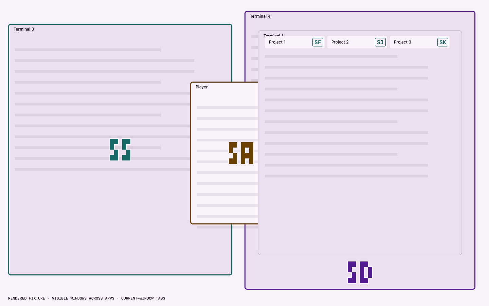
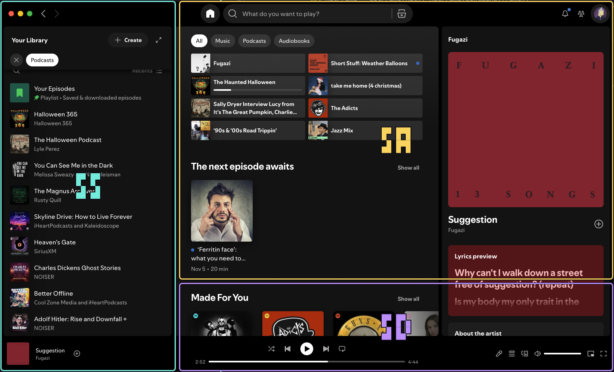
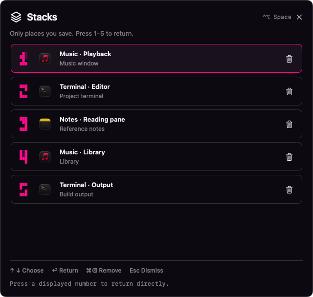
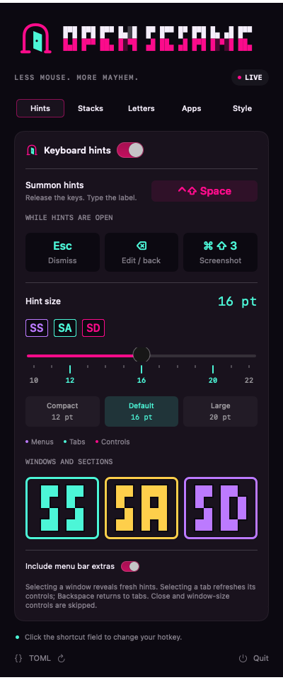

<p align="center">
  <picture>
    <source srcset="asset/logo-dark.svg" media="(prefers-color-scheme: dark)">
    <source srcset="asset/logo-light.svg" media="(prefers-color-scheme: light)">
    
  </picture>
</p>

<p align="center">Your Mac. A hotkey. A little keyboard witchcraft.</p>

<p align="center">
  <a href="LICENSE"></a>
  <a href="https://www.swift.org"></a>
  
  <a href="https://github.com/dduan/TOMLDecoder"></a>
  <a href="https://conventionalcommits.org"></a>
  <a href="https://just.systems"></a>
  <a href="https://github.com/tekk/hovnokod-badge"></a>
</p>

I built this for myself because I wanted Vimium-style keyboard hints across
my Mac, including Ghostty tabs, separate windows, and the menu bar, with a
hotkey and hint size I could tune from the menu bar.

OpenSesame now uses one navigation flow across apps: choose a window, narrow a
busy view into up to three sections, then select a control. Large selectors use
the original block lettering; compact tags keep colors by type. Save up to five
places when you want to return quickly.

<table align="center">
  <tr>
    <td align="center" width="50%"><a href="asset/layout-window-selection-light.png"></a></td>
    <td align="center" width="50%"><a href="asset/screenshots/spotify-sections.png"></a></td>
  </tr>
  <tr>
    <td align="center"><sub>Choose a window · rendered example</sub></td>
    <td align="center"><sub>Choose a section · cropped live capture</sub></td>
  </tr>
  <tr>
    <td align="center"><a href="asset/stacks-places-dark.png"></a></td>
    <td align="center"><a href="asset/settings-hints.png"></a></td>
  </tr>
  <tr>
    <td align="center"><sub>Return to a saved place · rendered example</sub></td>
    <td align="center"><sub>Tune the shortcuts · rendered settings</sub></td>
  </tr>
</table>

## Features

| Feature | What it does |
| --- | --- |
| Keyboard hints | Press one hotkey, then type a label to activate an accessible control. |
| Window selection | Block codes and colored borders select exposed windows across allowed apps, then reveal fresh hints in the chosen window. |
| Sections | Crowded views offer at most three regions per level. Select one to narrow its controls; Backspace restores the parent. |
| Tabs and groups | Current-window tabs have inline hints where they fit. Selecting a tab reveals its contents; Backspace returns to tab choices. Group headers use their primary selection action. |
| Menus and popups | Include app menus and optional menu bar extras. Hints refresh after menus open or hidden menu bar items expand. |
| Readable overflow | A paged panel keeps crowded choices reachable, with one source per page, local icons, and room for two-line titles. Desktop items never enter an app's list. |
| Desktop items | Gold corner tags identify exposed desktop files and expandable groups, even when Finder is inactive. |
| Saved stacks | Explicitly save up to five windows or sections, then recall them with 1–5. Places persist in TOML and renumber after removal. |
| Your keyboard | Configure shortcuts, hint size, alphabet, code length, and prefix. The default letters avoid similar-looking glyphs. |
| Your apps and style | Filter apps; choose six themes or custom colors, with system, light, and dark appearances. Settings persist in TOML. |

## Quickstart

For now, run from a checkout. Requires macOS 13+, Swift 6+ from Apple's
[Command Line Tools](https://developer.apple.com/xcode/resources/), and
[just](https://just.systems).

```sh
just start
```

1. Enable **OpenSesame** in **System Settings → Privacy & Security → Accessibility**
   when prompted.
2. Click the **open door** in the menu bar to adjust your preferences.
3. Focus an app and press **Control + Shift + Space**. Release the keys, then type
   the hint label to select a control. Click the shortcut field to change the hotkey.

Click outside the panel or press Escape to close it.

While hints are open, Escape dismisses them and Backspace edits the code or
returns to the parent section when the code is empty. Tab and Shift+Tab navigate
paged panels. Command+Shift+3 takes a screenshot without hiding
the hints. A click, scroll, or activation of another app dismisses ordinary
hints so old labels do not remain over a different window.

OpenSesame uses shared Accessibility discovery and action handling across apps.
It follows roles, advertised actions, and writable disclosure state; custom
interfaces may expose fewer controls. Window chrome such as close, minimize,
and maximize is excluded. Builds are ad-hoc signed and are not notarized.

For website icons, enable **Settings → Apps → Website icons for Chrome** and
allow macOS Automation access. This optional adapter reads Chrome's local icon
cache without network requests or saving tab addresses. Unavailable or ambiguous
icons use an app/group icon instead.

Chrome's tab-group hit-test handling and automatic window refresh have automated
coverage; they still need a live recheck after loading this build. The screenshots
illustrate layout, not proof that every app action succeeds. Finder desktop groups
use their advertised open/press action or writable disclosure state; their live
expand/collapse behavior also needs verification.

## Saved stacks

Stacks contain only places you explicitly save. Nothing is added by opening
hints, selecting a control, leaving hints, or switching apps.

1. Open hints in the window you want.
2. Drill into the section you want to return to (or stay at the window level).
3. Press **Control + Option + Return** to **Save stack**. The picker confirms
   the saved app and section. You can also open stacks with **Space** while
   hints are visible, then use its **Save** button for the displayed current place.

Change **Save stack** and **Show stacks** independently in **Settings → Stacks**,
or edit `[save_stack_shortcut]` and `[stacks_shortcut]` in `config.toml`.
The save binding applies while hints or the picker are open; other apps keep
that shortcut during ordinary typing.

Press **Control + Option + Space** to open stacks from any app, then **1–5** to
return to a saved place. Arrows and Return work too. Each place shows its app
icon. Keep up to five: a sixth save asks you to remove one first. Places stay
in order and are never automatically replaced. Saving the same place updates
its existing slot and combines confirmed duplicates, including after restart.

**Command–Backspace** or the remove button deletes the highlighted place without
closing its window. **Command–Z** undoes the last removal while the picker is
open. Remaining places renumber immediately from 1; undo restores their previous order.

While hints are open, **Space** opens stacks, **Return** resumes the last saved
place, and **Shift–Backspace** returns to the previous recalled stack. Plain
Backspace edits the code or goes up one navigation level.

Recall brings the saved window forward and scans fresh controls. It never
replays a control action. A changed region falls back to the window's current
choices; a closed or ambiguous window produces an explanation. All saved places
persist in `[stacks]` in `config.toml`. Old `stacks.json` favorites are imported
once, leaving the legacy file unchanged.

[See the stacks picker](asset/stacks-current-dark.png) (rendered example).

## Contributing

See [CONTRIBUTING.md](CONTRIBUTING.md) for development, testing, and troubleshooting.

## License

[MIT](LICENSE)
